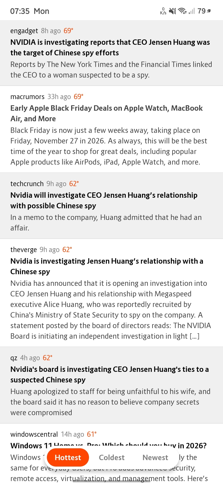

# Hotdroid — Hotnews for Android


Light              |Dark
:-----------------:|:---------------:
|

Native Android client for [Hotnews](https://news.lucianmarin.com) (`news.lucianmarin.com/api`), built with **Kotlin** and **Jetpack Compose**, mirroring the design of `../macnews` for macOS and the floating bottom navigation bar architecture of `../subdroid`.

---

## 1. Implementation & Specification Tracker

- [x] **Specification Document (`README.md`)**: Write down complete app, UI, navigation, icon, and API specifications and track progress.
- [x] **Backend Public API (`../news`)**:
  - [x] `GET /api/hot` — Paginated hottest news feed (`?p=1`, ordered by `-score, pub`, 1 per domain).
  - [x] `GET /api/cold` — Paginated coldest news feed (`?p=1`, ordered by `score, pub`, 1 per domain).
  - [x] `GET /api/new` — Paginated newest news feed (`?p=1`, ordered by `-pub`, 1 per domain).
  - [x] `GET /api/{site}` — Paginated site-specific news feed (`?p=1`, ordered by `-score, pub`).
- [x] **Android App Scaffolding & Icon (`../macnews/icon.svg`)**:
  - [x] Gradle Kotlin DSL setup (`build.gradle.kts`, `settings.gradle.kts`, `gradle/libs.versions.toml`) targeting Android API 26–35 (`compileSdk = 37`).
  - [x] Adaptive launcher icon (`ic_launcher.xml`, `ic_launcher_round.xml`, `ic_launcher_background.xml`, `ic_launcher_foreground.xml`) built from `../macnews/icon.svg`'s 5 warm vertical stripes (`#FBB03B`, `#F7931E`, `#F15A24`, `#ED1C24`, `#C1272D`).
- [x] **Data & State Layer (`Models`, `APIClient`, `SessionStorage`, `AppStateViewModel`)**:
  - [x] `FeedTab` (`Hottest`, `Coldest`, `Newest`), `NewsEntry`, `PaginatedNewsResponse`, and `NewsFormatter` (`shortDate`, `truncateSummary` at 480 chars, `siteName`, `siteNavigationLabel`, and `siteNavigationOptions` with `×`).
  - [x] Coroutine-based `APIClient` fetching `/api/hot`, `/api/cold`, `/api/new`, and `/api/{site}` from `https://news.lucianmarin.com`, with per-endpoint first-page caching (`?p=1` normalized to the plain endpoint call without `p` parameters).
  - [x] `NewsStateController` & `AppStateViewModel` managing active section (`Hottest`, `Coldest`, `Newest`), site/domain filter selection & closing back to `Hottest`, first-paint rendering from per-endpoint cache replaced in place when live endpoint content arrives, infinite scroll pagination, pull-to-refresh, and visited article/site persistence.
- [x] **Jetpack Compose UI (`NewsTheme`, `MainScaffold`, `BottomNavBar`, `FeedScreen`, `NewsRowView`)**:
  - [x] Floating bottom navigation bar (`BottomNavBar`) styled after `../subdroid`:
    - Displays **Hottest** (`Icons.Rounded.LocalFireDepartment`), **Coldest** (`Icons.Rounded.AcUnit`), and **Newest** (`Icons.Rounded.AccessTimeFilled`) sections with native Material Rounded icons when active.
    - When a site/domain is selected, displays an `Icons.Rounded.Info` button on the left to open the in-app **About** page (`AboutScreen`), the selected `<site>` option with `Icons.Rounded.StickyNote2` in the center, and a `Icons.Rounded.HighlightOff` close icon button on the right for closing the filter and returning to the **Hottest** section (also supported via Android system back).
    - When the **About** page is open, displays the active **About** pill (`Icons.Rounded.Info` + `"About"`) on the left, a `Icons.Rounded.StickyNote2` icon button in the middle to return to the site feed, and a `Icons.Rounded.HighlightOff` close icon button on the right.
    - When an article web page is opened in-app (`ArticleWebViewScreen`), keeps the floating nav bar pill visible displaying a `Icons.Rounded.Share` icon button on the left for copying the URL to the clipboard, the site domain (`<domain>` with `Icons.Rounded.Public`) in the center, and a `Icons.Rounded.HighlightOff` close icon button on the right.
  - [x] Alternating odd/even row highlighting (`#F0F0F0` Light / `#141414` Dark on odd rows; `#FFFFFF` Light / `#000000` Dark on even rows) with `1.dp` `--gainsboro` dividers between stories (no divider above the first story or below the last story) and a centered `520.dp` reading column (`560.dp` max width with `20.dp` horizontal padding).
  - [x] Article rows matching `news.lucianmarin.com` and `../macnews` (`site` + `age ago` + `score°` in `#FF4500`, bold clickable headline with visited state, 480-char `--darkgray` summary).
  - [x] Pull-to-refresh (`PullToRefreshBox`) and automatic infinite scroll (`LazyColumn` loading `?p=2`, `?p=3`, ...).
- [x] **Automated Unit Tests & Build Verification**:
  - [x] JUnit + Coroutines tests (`HotnewsTest.kt`) covering models, formatters, odd/even row highlighting, infinite scroll pagination, pull-to-refresh, tab switching, and site filter close returning to `Hottest`.
  - [x] Gradle test and debug APK build verification (`./gradlew testDebugUnitTest assembleDebug`).

---

## 2. Application Metadata & Build Configuration

| Property | Value |
| :--- | :--- |
| **App Name** | `Hotnews` |
| **Application ID / Package** | `com.lucianmarin.news` |
| **Language** | Kotlin 2.2 |
| **UI Framework** | Jetpack Compose (Material 3) |
| **Minimum SDK** | API 26 (Android 8.0) |
| **Target SDK** | API 35 (Android 15) |
| **Compile SDK** | API 37 |
| **Architecture** | Single-Activity (`MainActivity`), Shared State (`AppStateViewModel` / `NewsStateController`), Preferences Persistence (`SessionStorage`), Coroutines + Kotlinx Serialization (`APIClient`) |

---

## 3. Design System: Colors, Typography, Layout & Icon

### 3.1 Color Tokens (`NewsTheme.kt`)

Colors adapt to System, Light, or Dark mode, with OS status bar and navigation bar icon appearance synced automatically via `WindowCompat.getInsetsController`:

| Token (`NewsTheme`) | CSS Variable (`../news/static/style.sass`) | Light Mode Hex | Dark Mode Hex | Usage |
| :--- | :--- | :--- | :--- | :--- |
| `accent` | `orangered` | `#FF4500` | `#FF4500` | Active bottom nav button background, degree score (`79°`), pull-to-refresh spinner, error/retry text |
| `background` / `evenRowBackground` | `var(--white)` | `#FFFFFF` | `#000000` | Window background, even news rows (`2nd, 4th, 6th...`), floating nav bar background (light mode), active nav button text |
| `oddRowBackground` | `var(--whitesmoke)` | `#F0F0F0` | `#141414` | Highlighted odd news rows (`1st, 3rd, 5th...`), status row background, pull-to-refresh indicator container |
| `floatingBarBackground` | `var(--whitesmoke)` | `#FFFFFF` | `#181818` | Floating bottom navigation bar container background |
| `gainsboro` | `var(--gainsboro)` | `#E0E0E0` | `#242424` | `1.dp` horizontal row dividers (`NewsDivider`) |
| `silver` | `var(--silver)` | `#C0C0C0` | `#404040` | Muted UI accents |
| `gray` | `var(--gray)` | `#808080` | `#808080` | Inactive bottom nav button text, relative age (`35h ago`), status/loading text |
| `darkGray` / `visitedText` | `var(--darkgray)` | `#404040` | `#C0C0C0` | Article summary text and visited article headlines |
| `primaryText` | `var(--black)` | `#000000` | `#FFFFFF` | Unvisited article headlines and clickable site/domain labels |

### 3.2 Typography (`Route159FontFamily`)

| Style | Font Family | Weight | Size | Line Height | Usage |
| :--- | :--- | :--- | :--- | :--- | :--- |
| **Headline (`.title`)** | `Route 159` | Bold | `14.sp` | `20.sp` | Clickable article title (`primaryText` when unvisited, `visitedText` when visited) |
| **Summary (`.summary`)** | `Route 159` | Normal | `14.sp` | `20.sp` | Truncated article description (`480` characters max with `...`) in `darkGray` |
| **Metadata (`.small`)** | `Route 159` | Normal | `13.sp` | `16.sp` | `site` (`primaryText`) + `age ago` (`gray`) + `degrees°` (`accent`) |
| **Bottom Nav Button** | `Route 159` | Bold | `14.sp` | `20.sp` | Floating bottom navigation items (`Hottest`, `Coldest`, `Newest`, or `<site>` and `×`) |

### 3.3 Floating Bottom Navigation Bar (`BottomNavBar.kt`)

- Styled after `../subdroid`'s `SidebarView`, floating centered at the bottom with `10.dp` bottom margin (`navigationBarsPadding().padding(bottom = 10.dp)`), `10.dp` corner radius, `4.dp` shadow elevation, `6.dp` inner padding, and `4.dp` spacing between buttons (`46.dp` total bar height).
- **Section Mode (`selectedSite == null`)**:
  - Displays 3 buttons: **Hottest** (`/api/hot`), **Coldest** (`/api/cold`), and **Newest** (`/api/new`).
  - Selected section uses `NewsTheme.accent` (`#FF4500`) pill background with `NewsTheme.background` text and its native Material Rounded icon (`Icons.Rounded.LocalFireDepartment` for Hottest, `Icons.Rounded.AcUnit` for Coldest, `Icons.Rounded.AccessTimeFilled` for Newest); unselected sections use `NewsTheme.gray` text on a transparent background.
  - Switching sections animates the pill background and text colors (`animateColorAsState`) and fades/expands the active icon in and out (`AnimatedVisibility` with `fadeIn`/`fadeOut` + `expandHorizontally`/`shrinkHorizontally` and `Crossfade`).
- **Site / Domain Filter Mode (`selectedSite != null`)**:
  - Tapping a site/domain name in any article row filters the feed to `/api/{site}`.
  - The floating bottom navigation bar cross-fades (`AnimatedContent`) from the 3 section buttons to display a `Icons.Rounded.Info` button on the left to open the About page, the active `<site>` button (highlighted in `NewsTheme.accent` with `NewsTheme.background` text and `Icons.Rounded.StickyNote2`) in the center, and a `Icons.Rounded.HighlightOff` close icon button on the right.
  - Tapping the close icon button (or pressing the Android system Back button) closes the site filter and returns to the **Hottest** section (`/api/hot`).
- **About Mode (`isAboutOpen == true`)**:
  - Tapping the `Icons.Rounded.Info` button in the site filter nav bar opens the in-app **About** page (`AboutScreen`), displaying the 6 sections (`About Hotnews`, `Install as a web app`, `Tech stack and support`, `Features and design constraints`, `55 publications`, and `Contact and privacy`) from `../news/templates/about.html` and `../news/templates/privacy.html` styled identically to article rows (alternating odd/even row backgrounds, `1.dp` `--gainsboro` dividers, bold `14.sp` section titles, and `14.sp` `--darkgray` body text with clickable links).
  - The floating bottom navigation bar displays the active **About** pill (`Icons.Rounded.Info` + `"About"`) on the left, a `Icons.Rounded.StickyNote2` icon button in the middle to return to the site filter feed, and a `Icons.Rounded.HighlightOff` close icon button on the right.
- **Web Page Mode (`activeWebUrl != null`)**:
  - Tapping an article headline opens the web page in an in-app `WebView` (`ArticleWebViewScreen`) while keeping the floating bottom navigation bar pill visible on top.
  - The floating bottom navigation bar cross-fades to display a `Icons.Rounded.Share` icon button on the left to copy the current URL to the clipboard, the site domain (`<domain>` highlighted in `NewsTheme.accent` with `Icons.Rounded.Public`) in the center, and a `Icons.Rounded.HighlightOff` close icon button on the right to close the web page.
  - Tapping the domain button closes the web page and filters the feed by that site (`/api/{site}`).

### 3.4 App Icon (`../macnews/icon.svg`)

- Built from `../macnews/icon.svg` featuring 5 vertical warm stripes (`#FBB03B`, `#F7931E`, `#F15A24`, `#ED1C24`, `#C1272D`) in `res/drawable/ic_launcher_background.xml`, `res/drawable/ic_launcher_foreground.xml`, and `res/mipmap-anydpi-v26/ic_launcher*.xml`.

---

## 4. Public API Specification (`../news`)

Base URL: `https://news.lucianmarin.com`

| Endpoint | Query Params | Order | Description |
| :--- | :--- | :--- | :--- |
| `GET /api/hot` | `?p=<page>` (default `1`) | `-score, pub` | Hottest articles (highest similarity score, 1 per domain, 10 per page). |
| `GET /api/cold` | `?p=<page>` (default `1`) | `score, pub` | Coldest articles (lowest similarity score, 1 per domain, 10 per page). |
| `GET /api/new` | `?p=<page>` (default `1`) | `-pub` | Newest articles (most recently published, 1 per domain, 10 per page). |
| `GET /api/{site}` | `?p=<page>` (default `1`) | `-score, pub` | All recent articles from a specific `site` (10 per page). |

---

## 5. Project Structure

```text
hotdroid/
├── README.md
├── icon.svg
├── build.gradle.kts
├── settings.gradle.kts
├── gradle.properties
├── gradle/
│   └── libs.versions.toml
└── app/
    ├── build.gradle.kts
    └── src/
        ├── main/
        │   ├── AndroidManifest.xml
        │   ├── java/com/lucianmarin/news/
        │   │   ├── HotnewsApplication.kt
        │   │   ├── MainActivity.kt
        │   │   ├── model/
        │   │   │   └── Models.kt
        │   │   ├── network/
        │   │   │   └── APIClient.kt
        │   │   ├── state/
        │   │   │   ├── AppStateViewModel.kt
        │   │   │   └── SessionStorage.kt
        │   │   └── ui/
        │   │       ├── navigation/
        │   │       │   ├── BottomNavBar.kt
        │   │       │   └── MainScaffold.kt
        │   │       ├── screens/
        │   │       │   ├── FeedScreen.kt
        │   │       │   └── NewsRowView.kt
        │   │       └── theme/
        │   │           └── NewsTheme.kt
        │   └── res/
        │       ├── drawable/
        │       │   ├── ic_launcher_background.xml
        │       │   └── ic_launcher_foreground.xml
        │       ├── font/
        │       │   ├── route159_bold.ttf
        │       │   └── route159_regular.ttf
        │       ├── mipmap-anydpi-v26/
        │       │   ├── ic_launcher.xml
        │       │   └── ic_launcher_round.xml
        │       ├── values/
        │       │   ├── strings.xml
        │       │   └── themes.xml
        │       └── values-night/
        │           └── themes.xml
        └── test/
            └── java/com/lucianmarin/news/
                └── HotnewsTest.kt
```

---

## 6. Building & Testing

```bash
# Run unit tests
./gradlew testDebugUnitTest

# Build debug APK
./gradlew assembleDebug
```
